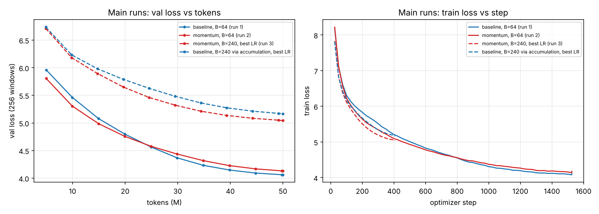
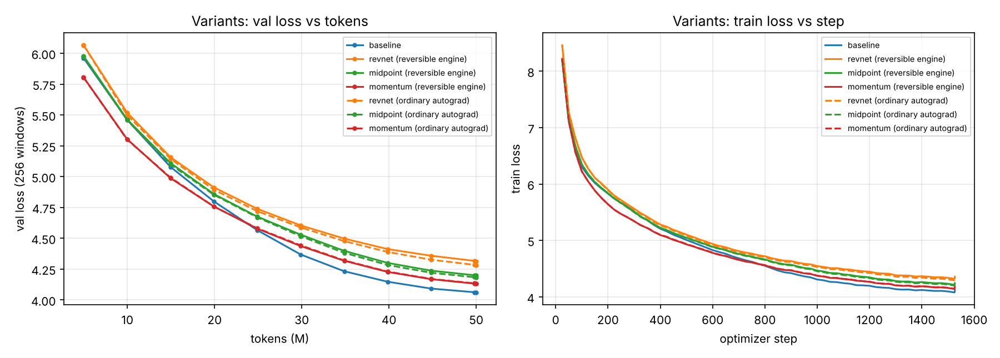
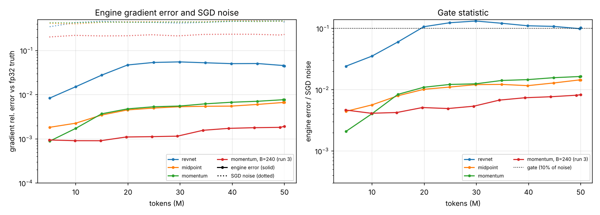
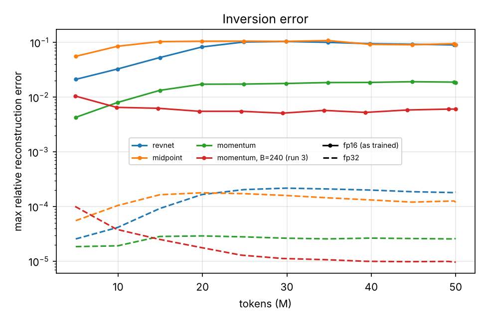
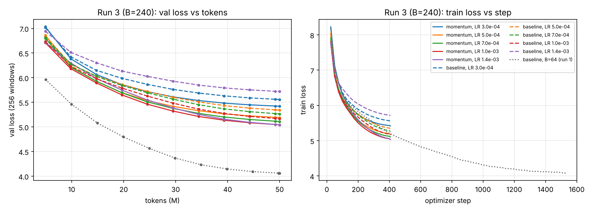
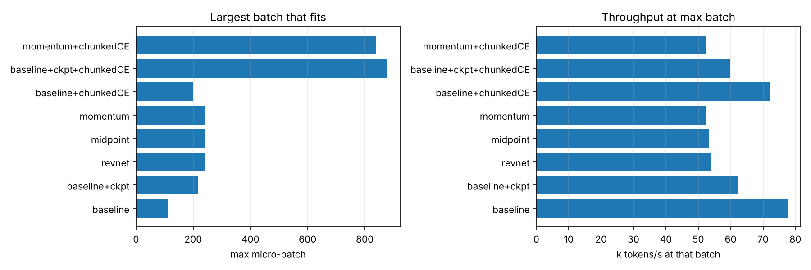
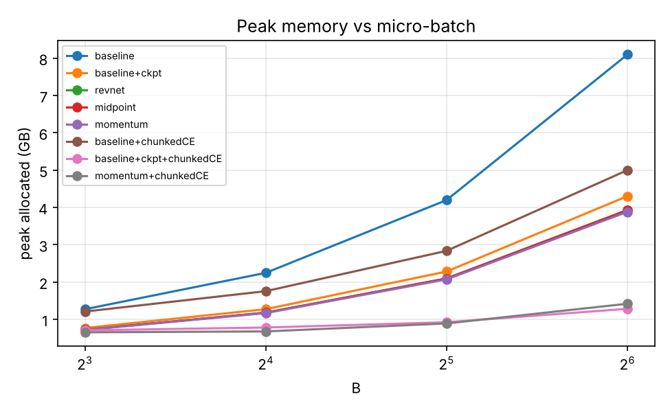
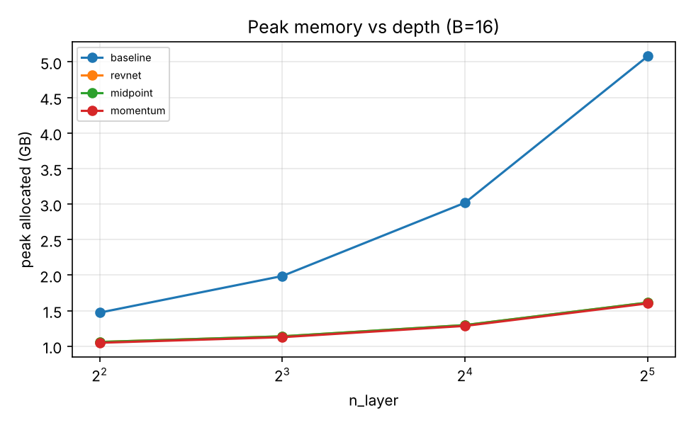

# Reversible GPT: trading compute for memory in a 21M-parameter LLM

A 21.05M-parameter GPT trained on 50M FineWeb-Edu tokens, with and without reversible residual blocks, on a single Colab **Tesla T4** (fp16). The whole experiment is one notebook, [`rev_gpt.ipynb`](rev_gpt.ipynb), committed with every output from the run reported here: 22 training runs, 4.7 hours of training. Every number below comes from [`results/`](results/), and every figure from [`assets/`](assets/), both produced by that notebook from this run.

---

## Answer to the brief

| | Run 1: baseline | Run 2: reversible (momentum) | Run 3: reversible at max batch |
|---|---|---|---|
| Micro-batch | 64 (largest power of two that fits) | 64 | **240** (largest that fits) |
| Optimizer steps / tokens | 1,526 / 50.004M | 1,526 / 50.004M | 407 / 50.012M |
| **Final val loss** (1M held-out tokens) | **4.102** (3 seeds: 4.108 ± 0.005 SE) | **4.172** (3 seeds: 4.166 ± 0.004 SE) | **5.056** (best of 5 LRs) |
| **Speed** | **77,634 tokens/s** | **55,484 tokens/s** (−28.5%) | **52,583 tokens/s** |
| **Peak memory** (training) | **8.10 GB** | **3.88 GB** (−52.1%) | **13.83 GB** (of 14.6 GB) |
| MFU (T4, 65 TFLOPS fp16) | 17.8% | 12.7% | 12.0% |
| Training time | 10.7 min | 15.0 min | 15.9 min |

- **Variant that worked: momentum** (Momentum ResNet, `v' = γv + (1−γ)·D(x)`, γ = 0.9). All three variants trained on the full budget, each next to an autograd twin. Momentum had the lowest loss and passed the numerics gate. Midpoint (leapfrog) also passed but finished 0.069 worse. RevNet (symplectic Euler) failed the gate, and its engine measurably cost loss.
- **Memory saved:** −52% peak memory at the same batch, for −28.5% throughput and +0.058 ± 0.006 loss. The loss cost belongs to the momentum *architecture*, not to the reversible backward (engine effect −0.004).
- **Max batch:** the saved memory fits 240 sequences, 2.14× the baseline's own maximum of 112. On a fixed 50M-token budget it bought no speed, because the T4 was already saturated at B = 64. It cost about one nat of loss, because the same tokens buy 3.75× fewer optimizer steps. That penalty hits both architectures; at the large batch, momentum is 0.124 *better* than an equally tuned baseline.
- **Bottom line:** at this scale, **activation checkpointing is the better tool**. It fits 90% of the reversible maximum batch at 19% higher throughput, with exact gradients and no architecture change. Reversibility's advantage is depth scaling, which a 10-layer model barely exercises.

---

## Key findings

1. **Momentum is the variant that worked, and the numerics gate predicted the one that didn't.** Final val loss: momentum 4.172, midpoint 4.241, revnet 4.352 (baseline 4.102). The gate compares the engine's gradient error with SGD gradient noise. Momentum and midpoint stay under 2% of the noise for the whole run. RevNet climbs to 10–13% after 20M tokens, and it is the only variant whose engine measurably hurts loss: +0.031 against its autograd twin, outside the ±0.020 two-sigma band for a single pair. Midpoint's +0.015 is inside the band; momentum's −0.004 is noise.

2. **At equal batch, reversibility halves memory for a 29% speed cost.** Peak training memory falls from 8.10 to 3.88 GB (−52.1%). Throughput falls from 77,634 to 55,484 tokens/s (−28.5%), slightly more than the −25% implied by one extra forward pass per step (4 forward-equivalents instead of 3). The loss cost over three seeds each is +0.058 ± 0.006 SE (9.8 SE): small, but real.

3. **That loss gap is the architecture, not the reversible backward.** Momentum trained with ordinary autograd reaches 4.176, against 4.172 with the memory-saving engine (Δ −0.004, below the run-to-run sd of 0.007). The two validation curves stay within 0.006 of each other throughout. The momentum architecture itself leads the baseline by about 0.16 for the first 10M tokens, crosses over near 25M tokens, and finishes 0.07 behind.

4. **Max batch bought no speed, and cost about a nat of loss at this budget.** Momentum fits 240 sequences: 3.75× the fixed batch of 64, and 2.14× the baseline's own maximum of 112. But the T4 was already saturated at B = 64. Momentum's throughput fell 5% at B = 240 (55,484 → 52,583), and the baseline gains nothing between 64 and 112 (77,634 → 77,689). With tokens fixed, the larger batch means 3.75× fewer optimizer steps (1,526 → 407), so loss rises by about one nat for both architectures: baseline +1.07, momentum +0.89, against their B = 64 seed means.

5. **At large batch, momentum beats the baseline by 0.12, after tuning both.** Both were swept over the same LR grid (3e-4 to 1.4e-3) at the same effective batch of 240; the baseline used gradient accumulation (60 × 4). Momentum is better at every LR, and best against best it is 5.056 vs 5.180 (−0.124). Its autograd twin at B = 240 reaches 5.058, so this too is the architecture. It is the same early-training lead as in finding 3: 407 steps is before the crossover. The baseline is also more LR-sensitive. At 1.4e-3 it falls behind within ~50 steps and finishes at 5.727, with no divergence and normal gradient norms; momentum is unchanged (5.056).

6. **Activation checkpointing wins at this scale; reversibility wins on depth.** Checkpointing the baseline fits 216 sequences (90% of momentum's 240) at 62,092 vs 52,386 tokens/s (19% faster). Both are limited by the LM head, which accounts for 87 of momentum's 116 KB/token of activation memory. With the head removed by a chunked loss, checkpointing still edges ahead: 880 vs 840 max batch, 21 vs 29 KB/token. Depth is reversibility's advantage. From 4 to 32 layers at B = 16, baseline peak memory grows from 1.47 to 5.08 GB. Every reversible variant grows only from 1.05 to 1.60 GB, roughly the weights and AdamW state of the 28 added layers (49.5M parameters × 12 bytes ≈ 0.59 GB). Checkpointing stores one fp32 input per layer (1.5 KB/token each), so deeper models favour reversibility; the crossover depth was not measured (see Limitations).

7. **The v1 momentum failure is fixed, and the remaining drift is half-precision recomputation.** The first version used an unnormalised update, `v' = γv + D(x)`. Its trained model had reconstruction error 2.0 (200%) and gradient cosine 0.94. With `v' = γv + (1−γ)·D(x)`, reconstruction error is 1.8e-2 under fp16, and the gradient cosine to the fp32 truth stays ≥ 0.99997. In all three variants, fp32 reconstruction is 500–750× more accurate than fp16 (midpoint: 9.0e-2 vs 1.2e-4). The drift therefore comes from recomputing sublayers in half precision, not from the schemes' algebra.

---

## Results

### Main runs and seeds

| Run | Arch | Micro × accum | Peak LR | Steps | Tokens | Final val loss | Tokens/s | MFU | Peak memory (GB) | Time (min) |
|---|---|---|---|---|---|---|---|---|---|---|
| `run1_baseline` | baseline | 64 × 1 | 1.0e-3 | 1,526 | 50.004M | 4.1016 | 77,634 | 17.8% | 8.10 | 10.7 |
| `seed_baseline_s1338` | baseline | 64 × 1 | 1.0e-3 | 1,526 | 50.004M | 4.1051 | 77,476 | 17.7% | 8.10 | 10.8 |
| `seed_baseline_s1339` | baseline | 64 × 1 | 1.0e-3 | 1,526 | 50.004M | 4.1173 | 77,385 | 17.7% | 8.10 | 10.8 |
| `run2_momentum` | momentum (engine) | 64 × 1 | 1.0e-3 | 1,526 | 50.004M | 4.1718 | 55,484 | 12.7% | 3.88 | 15.0 |
| `seed_momentum_s1338` | momentum (engine) | 64 × 1 | 1.0e-3 | 1,526 | 50.004M | 4.1597 | 55,601 | 12.7% | 3.88 | 15.0 |
| `seed_momentum_s1339` | momentum (engine) | 64 × 1 | 1.0e-3 | 1,526 | 50.004M | 4.1668 | 55,581 | 12.7% | 3.88 | 15.0 |
| `run3_momentum_B240_lr1.0e-03` | momentum (engine) | 240 × 1 | 1.0e-3 | 407 | 50.012M | 5.0555 | 52,583 | 12.0% | 13.83 | 15.9 |
| `ctrl_baseline_accum_B240_lr1.0e-03` | baseline | 60 × 4 | 1.0e-3 | 407 | 50.012M | 5.1800 | 78,567 | 18.0% | 7.69 | 10.6 |
| `ctrl_momentum_autograd_B240` | momentum (autograd) | 80 × 3 | 1.0e-3 | 407 | 50.012M | 5.0578 | 72,867 | 16.7% | 10.13 | 11.4 |

**Seed statistics** (final val loss): baseline 4.1080 ± 0.0047 SE (n = 3, sd 0.0082); momentum 4.1661 ± 0.0035 SE (n = 3, sd 0.0061). Gap: +0.0581 ± 0.0059 SE. Throughput varies by under 0.4% across seeds.



*Colour = architecture (blue baseline, red momentum); dashed = trained at B = 240. Left: validation loss against tokens (256-window evals during training). Right: training loss against optimizer step. Momentum leads the baseline until about 25M tokens, then trails. The B = 240 runs see the same 50M tokens in 407 steps instead of 1,526. Per step they are ahead of the B = 64 runs (right), because each step sees 3.75× more data. Per token they lag by about one nat (left).*

### Reversible variants, each with an autograd twin

All variants ran at B = 64 on the full budget, from the same initial weights and data order as run 1. "Autograd" is the same architecture trained with ordinary backprop, so **engine effect** = engine − autograd and **architecture effect** = autograd − baseline (4.1016).

| Variant | Val loss (engine) | Val loss (autograd) | Engine effect | Architecture effect | Tokens/s | Peak (GB) | p90 engine error / SGD noise | Min cosine to fp32 truth | Recon. error at end (fp16 / fp32) | Gate |
|---|---|---|---|---|---|---|---|---|---|---|
| `revnet` (symplectic Euler) | 4.3516 | 4.3208 | **+0.031** | +0.219 | 58,517 | 3.93 | **0.124** | 0.9985 | 9.1e-2 / 1.8e-4 | **fail** |
| `midpoint` (leapfrog) | 4.2409 | 4.2254 | +0.015 | +0.124 | 57,806 | 3.93 | 0.0145 | 0.99998 | 9.0e-2 / 1.2e-4 | pass |
| **`momentum`** | **4.1718** | 4.1755 | −0.004 | +0.074 | 55,484 | 3.88 | 0.0164 | 0.99997 | 1.8e-2 / 2.6e-5 | **pass, selected** |

A single paired difference is judged against the run-to-run sd (pooled 0.0072, so a two-sigma band of ±0.020 for one pair). Only revnet's engine effect falls outside it.



*Colour = architecture; solid = reversible engine, dashed = the same architecture trained with ordinary autograd. Each pair overlaps almost exactly, except revnet (orange), which separates from about 10M tokens and ends 0.03 apart. All three architectures finish behind the baseline.*

### Numerics during training



*Each run keeps one colour in both panels. Left: engine gradient error (solid) and SGD gradient noise (dotted), both relative to the fp32 truth. Right: their ratio, the gate statistic, with the gate at 10% (dotted line). RevNet (blue) crosses it after 20M tokens; momentum and midpoint stay below 2%. For reference, mixed-precision autograd alone has an error of about 0.4% of the noise.*



*Maximum relative error when rebuilding each layer's input from its output, one colour per run: solid in fp16 (as trained), dashed in fp32. The gap of roughly three orders of magnitude shows that the drift comes from half-precision recomputation.*

### Run 3: LR sweep at the maximum batch, against a tuned baseline

Both runs used the same effective batch (240) and the same 50M tokens (407 steps). The grid started at 3e-4–1e-3 and extended itself to 1.4e-3, because both sweeps' best LR was on the upper edge.

| Peak LR | Momentum (engine), B = 240 | Baseline, 60 × 4 accumulation | Momentum − baseline |
|---|---|---|---|
| 3.0e-4 | 5.4335 | 5.5676 | −0.134 |
| 5.0e-4 | 5.2036 | 5.3547 | −0.151 |
| 7.0e-4 | 5.1252 | 5.2762 | −0.151 |
| **1.0e-3** | **5.0555** | **5.1800** | **−0.124** |
| 1.4e-3 | 5.0557 | 5.7274 | −0.672 |

The momentum autograd twin at B = 240 and LR 1e-3 reaches 5.0578, an engine effect of −0.002. The baseline's optimum (1e-3) is clearly interior. Momentum's is flat between 1e-3 and 1.4e-3 (the notebook's report flags it as a flat optimum), so its true optimum may lie slightly higher, which would only widen its lead.



*Colour = peak LR; solid = momentum, dashed = baseline at the same effective batch and LR; dotted grey = run 1 for reference. Every solid curve sits below its dashed partner. The baseline at 1.4e-3 (purple, dashed) falls behind early and stays there.*

### Max batch vs max batch

Each configuration at its own largest micro-batch on the 14.6 GB T4, with throughput timed at that batch. `+ckpt` is activation checkpointing of every block; `+chunkedCE` computes the LM head and loss in checkpointed chunks of 4,096 tokens, so the B·T·V logits tensor never exists.

| Configuration | Max micro-batch | Peak at max (GB) | Tokens/s at max |
|---|---|---|---|
| baseline | 112 | 13.95 | 77,689 |
| baseline + ckpt | 216 | 13.90 | 62,092 |
| revnet | 240 | 14.00 | 53,809 |
| midpoint | 240 | 14.00 | 53,360 |
| momentum | 240 | 13.83 | 52,386 |
| baseline + chunkedCE | 200 | 14.19 | 71,965 |
| baseline + ckpt + chunkedCE | 880 | 14.15 | 59,911 |
| momentum + chunkedCE | 840 | 14.23 | 52,311 |



### Where the memory goes

Peak memory was measured at B = 8, 16, 32 and 64, and a line fitted per configuration. The slope is activation memory per token; the intercept is the fixed cost. Weights, gradients and AdamW states total 0.31 GB.

| Configuration | Fixed cost (GB) | Activation cost (KB/token) |
|---|---|---|
| baseline | 0.29 | 249.7 |
| baseline + ckpt | 0.26 | 129.3 |
| revnet | 0.26 | 117.3 |
| midpoint | 0.26 | 117.3 |
| momentum | 0.26 | 115.8 |
| baseline + chunkedCE | 0.67 | 138.5 |
| baseline + ckpt + chunkedCE | 0.61 | 21.1 |
| momentum + chunkedCE | 0.48 | 29.1 |

The chunked configurations have a larger fixed cost because one 4,096-token chunk of logits is allocated regardless of batch size. Chunking removes 87 of momentum's 116 KB/token, so the LM head, not the transformer blocks, is the memory floor at this model size.



Peak memory against depth at B = 16:

| Layers | baseline | revnet | midpoint | momentum |
|---|---|---|---|---|
| 4 | 1.47 GB | 1.06 GB | 1.06 GB | 1.05 GB |
| 8 | 1.99 GB | 1.14 GB | 1.14 GB | 1.13 GB |
| 16 | 3.02 GB | 1.30 GB | 1.30 GB | 1.29 GB |
| 32 | 5.08 GB | 1.61 GB | 1.61 GB | 1.60 GB |



### Hypothesis scorecard

Hypotheses H1–H5 were written before the v2 runs and are scored here unchanged.

| # | Hypothesis | Measured | Verdict |
|---|---|---|---|
| H1 | `revnet` and `midpoint` pass the numerics gate; `momentum` is the most fragile | No variant passed the gate this was written for (v2). Under the v3 gate, revnet fails and momentum passes; revnet is the most fragile (p90 12.4% of noise vs 1.45% for midpoint and 1.64% for momentum) | **Not supported** |
| H2 | For the selected variant, the engine effect on loss is within seed noise | Momentum: −0.004 at B = 64 and −0.002 at B = 240, both below 1 sd (0.007) | **Supported** |
| H3 | Run 3 lands within 0.05 of the baseline at the same effective batch | −0.124, best against best, and better at every LR | **Not supported**, in reversibility's favour |
| H4 | Against checkpointing: under 1.15× the max batch with full logits, over 1.5× with a chunked loss | 1.11× with full logits; 0.95× with chunked loss (checkpointing fits more) | **Half true** |
| H5 | At equal batch: peak memory −40 to −60%, throughput −25 to −35% | −52.1% and −28.5% | **Supported** |

---

## Setup

| Item | Value |
|---|---|
| Data | FineWeb-Edu `sample-10BT`, streamed: 42,000 documents, 51.2M tokens written, 3.95 characters per token. Each run trains at least 50M tokens (step count rounded up: 50.004M at B = 64, 50.012M at B = 240) and sees no token twice. |
| Validation | 1,500 held-out documents = 1M tokens. **Final losses use all 1M.** Curves during training use the first 256 windows (131k tokens). |
| Tokenizer | Byte-level BPE, 8,192 tokens, trained on 20,000 documents that exclude the validation documents |
| Model | 10 layers, d = 384, 6 heads, context 512, MLP 4×, GELU, LayerNorm without bias, learned positions, tied embeddings: 21,045,120 parameters (17,702,784 non-embedding) |
| Optimizer | AdamW (β = 0.9, 0.95), weight decay 0.1 on matrices, clip 1.0, peak LR 1e-3, warmup max(5% of steps, 25), cosine to 10% |
| Precision | fp16 autocast + GradScaler (T4 has no bf16); residual stream always fp32 |
| Seeds | 1337 for every run; 1338 and 1339 added for runs 1 and 2. A seed fixes both initialisation and data order. |
| Hardware | Colab Tesla T4 (14.6 GB), PyTorch 2.11 |

**Why an 8k vocabulary.** With GPT-2's 50k vocabulary, about 19M of the 21M parameters would be embedding, and the logits tensor would dominate activation memory. Reversibility removes only *block* activations, so a huge head would hide the effect being measured. Even at 8k, the head turned out to be the largest consumer.

**Fairness controls.**
- All architectures have identical parameter tensors created in the same order, so a seed gives identical initial weights.
- Data is cut into non-overlapping 513-token windows in one seeded order, so every batch size consumes the same windows in the same order.
- Throughput excludes the first 5% of steps and all evaluation time.
- Peak memory covers training steps only. The evaluation and gradient-audit peak is recorded separately (3.84 GB at B = 64, below the reversible run's own 3.88 GB).

---

## Method

### Reversible schemes

A standard residual block, `x_{n+1} = x_n + F(x_n)`, is forward Euler on `dx/dt = F(x)`. It cannot be inverted in closed form, so backprop stores every layer's activations. A reversible scheme can be undone exactly: the backward pass rebuilds each layer's input from its output, so only the final state is stored. The price is one extra forward per layer, about +33% FLOPs.

With `F` the attention sublayer, `G` the MLP sublayer and `D(x) = F(x) + G(x + F(x))` the whole block's update:

| Variant | ODE view | Forward step | Exact inverse |
|---|---|---|---|
| `revnet` | Symplectic Euler on a split state (Gomez et al., 2017) | `y1 = x1 + F(x2)`, `y2 = x2 + G(y1)` | `x2 = y2 − G(y1)`, `x1 = y1 − F(x2)` |
| `midpoint` | Leapfrog / explicit midpoint (Chang et al., 2018) | `x_{n+1} = x_{n−1} + D(x_n)` | `x_{n−1} = x_{n+1} − D(x_n)` |
| `momentum` | Momentum ResNet (Sander et al., 2021) | `v' = γv + (1−γ)·D(x)`, `x' = x + v'` | `x = x' − v'`, `v = (v' − (1−γ)·D(x)) / γ` |

**Engine.** A custom `torch.autograd.Function` runs the block stack without storing activations and saves only the final state. In backward, each scheme's `backward_step` rebuilds the layer input and back-propagates through that layer, evaluating each sublayer once and reusing that evaluation for both reconstruction and gradient. `custom_fwd`/`custom_bwd` replay the forward's autocast state, so recomputation uses the same precision.

### Correctness checks

- **fp64 exactness:** engine against autograd in double precision gives relative gradient error **0.0** for all three schemes ([`results/correctness.json`](results/correctness.json)).
- **Chunked loss:** identical to the unchunked loss (difference < 1e-6) and gradients (< 1e-8).
- **Gradient audit during training,** at every evaluation (11 per run). The fp16 engine's gradients are compared with an fp32 autograd ground truth on 16 validation windows. The **SGD noise reference** comes from fp32 gradients on two disjoint 16-window batches, rescaled to the training batch B: `‖g_A − g_B‖ · √(16 / 2B) / ‖g_A‖`.

### Rules

- **Numerics gate (v3).** A variant passes if, at the 90th percentile of its audits, engine gradient error is ≤ 10% of SGD noise and cosine to the fp32 truth is ≥ 0.99. *This gate was designed after the v2 results, so it is not pre-registered.* The earlier v2 gate (engine error ≤ 3× the mixed-precision autograd error at every audit) is still computed, and no variant passes it. The mixed-precision error is itself only about 0.4% of SGD noise, so 3× of it is far below anything the optimizer can notice.
- **Selection.** Lowest final val loss among variants passing the gate.
- **Statistics.** Seed groups are reported as mean ± SE (n = 3). A difference of means counts as real above 2 SE. A single paired difference (engine − autograd) is compared with the run-to-run sd: below 1 sd it is called noise, and it counts as a real effect only outside ±2√2·sd = ±0.020.
- **LR sweeps at max batch.** The same grid for both architectures (3e-4, 5e-4, 7e-4, 1e-3). If a sweep's best LR is on the grid edge, one point is added beyond it (×1.4 or ÷1.4), at most twice.

---

## How the experiment got here

This is the third full GPU run. Each earlier run exposed design problems, and the fixes are part of the method.

| Version | What its run showed | What changed next |
|---|---|---|
| v1 | Momentum used an unnormalised update `v' = γv + D(x)`: trained-model reconstruction error 2.0 and gradient cosine 0.94. It was selected from 10M-token pilots on a compressed schedule, where all models sit near loss 6. Run 3 (val 5.82) had no control. "3.75× batch" compared reversible's maximum with the baseline's fixed batch, not its maximum (112). | `α = 1 − γ`. Every variant on the full budget. fp32-truth gradient audit. LR sweep plus an accumulation control at max batch. Max-vs-max table including checkpointing. Three seeds. |
| v2 | Tokens/s was inflated: an evaluation landing between two log points reset the segment timer but not its token count. Run 3's best LR sat on the grid edge, and the baseline control was not tuned. The audit used 2 windows, took a maximum, and its 3× threshold was arbitrary. Only the winner had an autograd control. Some "±" values were sds, not SEs. | Timing fix. Training-only peak memory. Whole-name GPU lookup for MFU. LR grid from 3e-4 with auto-extension, shared by both sides. 16-window audit against SGD noise at p90. Autograd twins for all variants. Mean ± SE. Computed scorecard. |
| v3 | This README. | Reporting fixes after the run (below); no change to any experiment. |

### Reporting fixes after the run

The notebook's Step 8 turns `results/` into tables, a hypothesis scorecard and computed findings. Checking that text against the data after the run found four wording bugs in the reporting code (cell [10]). They are fixed in the notebook:

| Bug | Fix |
|---|---|
| Checkpointing's throughput edge was computed in the wrong direction: "16% higher", but checkpointing is **19%** faster (62,092 vs 52,386 tokens/s) | The ratio is now checkpointing ÷ reversible, and both throughputs are printed |
| A fixed sentence claimed "reversibility's advantage appears only once the head is chunked". The data say the opposite: with a chunked loss, checkpointing fits 880 vs momentum's 840 | The sentence is now derived from the chunked-loss max-batch results |
| The selection note said the v2 gate "would have selected `midpoint`". In fact no variant passes that gate; midpoint was only a fallback, chosen with the wrong statistic | The note reports that no variant passes it, with each variant's worst ratio. `results/selection.json` was regenerated with the corrected note |
| The H3 verdict omitted the direction of the gap, and the step ratio printed as 3.7× | The verdict reads "not supported: reversible better"; the ratio is 3.75× |

The plots were also made clearer: one colour per run across both gradient-audit panels, shared colours for engine/autograd and reversible/baseline pairs, and legends moved off the data.

**How this was verified.** The cells that only render results (the Step 5 selection note and the Step 8 plots and report) were re-executed with the fixed code against the saved `results/`, without retraining anything. The five data tables of the report (main runs, variants, run-3 sweep, max batch, probes), and every table displayed in Steps 5–8, came out byte-identical to the ones generated on Colab. Only the three text sections changed. All training cells in the notebook keep their original Colab output.

---

## Limitations

- **Seeds:** three seeds cover runs 1 and 2 only. Variants, controls and run 3 are single runs, judged against the seed spread.
- **Gate validation:** the v3 gate was designed after the v2 results, and its threshold is supported by a single failing case (revnet).
- **LR tuning:** both LR sweeps pick their best LR on the validation set, so both best losses are slightly optimistic. The same procedure on both sides keeps the comparison fair.
- **Depth crossover:** checkpointing was not included in the depth probe, so the depth at which reversibility overtakes it is not measured. A rough extrapolation, from checkpointing's 1.5 KB/token per extra layer against the 8 KB/token gap with a chunked loss, puts it near 15 layers. That figure is an estimate.
- **Chunked loss scope:** training used the full logits tensor; the chunked loss was measured in the memory probes only.
- **Precision and hardware:** one GPU type in fp16. bf16 on newer GPUs has 3 fewer mantissa bits, so recomputation error would likely be larger; this is untested.
- **Fixed γ:** momentum's γ was fixed at 0.9.
- **No `torch.compile`:** it was off for every run, because the custom backward calls autograd inside autograd. Absolute tokens/s is below what a compiled baseline would reach.

---

## Reproduce

1. Open [`rev_gpt.ipynb`](rev_gpt.ipynb) in Colab and select **Runtime → Change runtime type → T4 GPU**.
2. Optionally set `USE_DRIVE = True` in the first code cell, so results survive a disconnect. Run all then resumes from the first unfinished run.
3. Select **Runtime → Run all**. The default `BUDGET = "full"` took 4.7 hours of training on a T4 (22 runs). `BUDGET = "core"` runs 9 of them in about 2 hours.

The notebook downloads and tokenises the data, runs every experiment, writes the plots, and finishes with a zip of the results.

## Repository

```
rev_gpt.ipynb     the whole experiment: code cells [0]-[10], then Steps 1-9, with all outputs from this run
README.md         this report
results/          22 run files (curves, metrics, gradient audits) + batch_plan, correctness,
                  selection, max_batch and probes JSON
assets/           the 8 figures above, rendered by the notebook's Step 8 from this run's results
```

## References

- Gomez, Ren, Urtasun, Grosse (2017). *The Reversible Residual Network: Backpropagation Without Storing Activations.* NeurIPS.
- Chang, Meng, Haber, Ruthotto, Begert, Holtham (2018). *Reversible Architectures for Arbitrarily Deep Residual Neural Networks.* AAAI.
- Sander, Ablin, Blondel, Peyré (2021). *Momentum Residual Neural Networks.* ICML.
- Kitaev, Kaiser, Levskaya (2020). *Reformer: The Efficient Transformer.* ICLR.
- Chen, Xu, Zhang, Guestrin (2016). *Training Deep Nets with Sublinear Memory Cost.* arXiv:1604.06174.
- Chowdhery et al. (2022). *PaLM: Scaling Language Modeling with Pathways*, Appendix B (FLOPs and MFU accounting).
